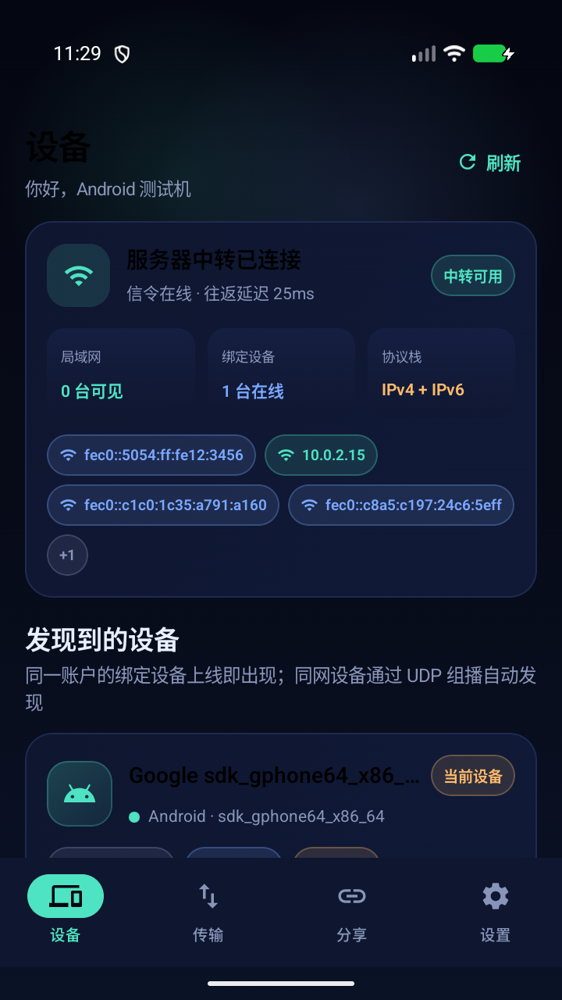
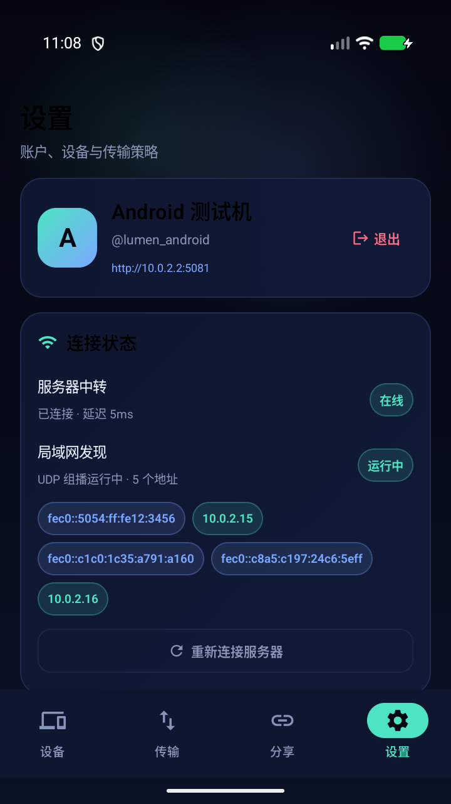
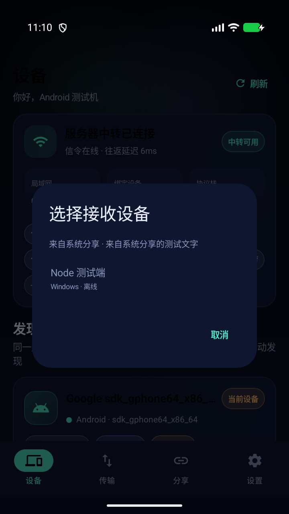
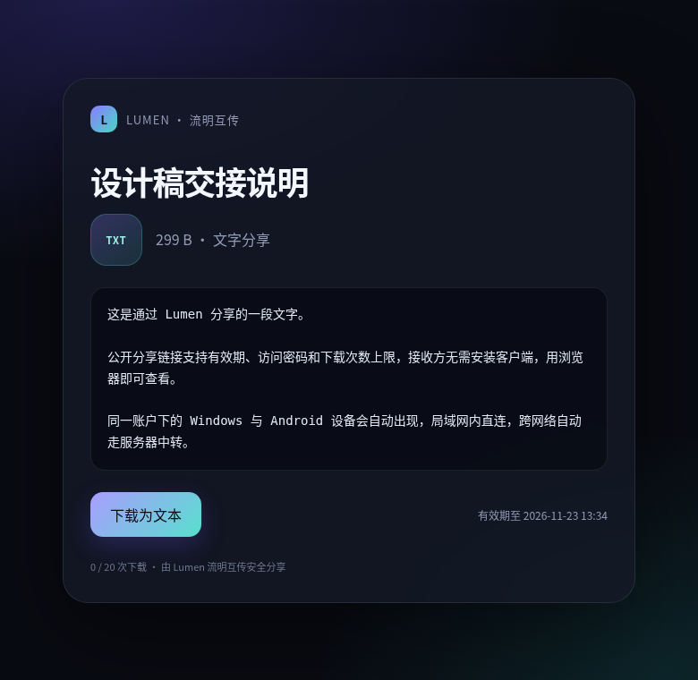
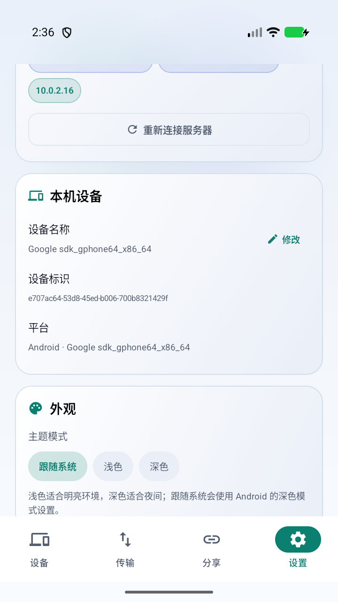

# Lumen · 流明互传

> 局域网直连优先的跨设备互传。Windows、Android 与浏览器之间，文件、图片和文字一步送达。

[](https://github.com/2746267826/lumen/releases)
[](https://github.com/2746267826/lumen/actions/workflows/ci.yml)
[](https://github.com/2746267826/lumen/actions/workflows/docker.yml)

<p align="center">
  
  
  
</p>
<p align="center"><sub>Android 客户端实拍：设备发现 · 连接状态 · 系统分享入口</sub></p>

Lumen 把「传个文件」这件事做得既快又清楚。同一个账户下的设备上线就会互相出现，同一网络内自动直连，跨网络时自动走你自己的服务器中转——不需要选模式，也不需要扫码配对。

所有传输都有完整记录：走了哪条链路、用了 IPv4 还是 IPv6、速度多少、分块进行到哪一步，都能在界面里直接看到。需要发给没有安装客户端的人时，生成一个带有效期和密码的网页链接即可。

## 特性

### 传得快，也传得稳

- **局域网直连优先**：同一 Wi-Fi 下自动发现并点对点传输，不绕服务器，速度取决于你的网络。
- **跨网自动中转**：不在同一网络时自动切换服务器中转，链路变化无需手动操作。
- **失败自动回退**：直连探测失败、邀请超时或分块中断时自动改用中转；对方明确拒绝则不会打扰。
- **断点重试与完整性校验**：分块失败自动重试，每个分块校验 SHA-256，接收端合并后再校验整个文件。

### 设备自动出现

- **账户绑定**：Windows 和 Android 登录同一账户后，在线设备即刻出现在列表中，不用每次搜索局域网。
- **状态一目了然**：设备卡片直接标注「局域网直连」或「服务器中转」，并显示 IPv4 / IPv6、延迟和在线状态。
- **当前设备标记**：列表里能一眼分清哪台是自己，避免发错。

### 每一次传输都有据可查

- **本地与服务端双记录**：历史列表按时间排列，重启不丢。
- **完整传输详情**：文件大小、分块大小与数量、已完成分块、已传字节、瞬时与平均速度、两端地址、SHA-256、事件时间线。
- **可调分块大小**：256 KiB / 1 MiB / 4 MiB 按网络情况选择，大文件与小文件都合适。

### 分享给任何人

<p align="center">
  
</p>

- **一个链接就够**：文件、图片、文字都能生成公开分享页，接收方用浏览器打开，无需安装 Lumen。
- **有效期与密码**：可设置到期时间、访问密码和下载次数上限，服务端强制校验。
- **图片直接预览、文字直接阅读**：不用先下载再看。

### 原生客户端，而不是网页壳

- Windows 使用 **WPF (.NET 8)**，Android 使用 **Kotlin + Jetpack Compose**，两端都是真正的原生界面。
- Windows 与 Android 都支持浅色、深色和跟随系统主题，两套配色分别调整了文字对比度。
- Windows 标题栏右侧有明暗一键切换按钮，Android 在“设备与连接”里切换外观，选择都会被记住。
- Windows 关闭窗口后驻留系统托盘继续接收文件，托盘右键可查看链路状态或退出；再次启动会唤起已有窗口。
- 深色玻璃质感、流畅动效与自适应布局，手机横竖屏和桌面窗口都顺手。
- Windows 支持一键发送剪贴板内容；Android 可从相册、文件管理器或任意应用通过系统分享直接发给某台设备。
- Android 前台服务保持后台在线与接收，切到后台不会立刻掉线。

<p align="center">
  
</p>
<p align="center"><sub>Android 浅色模式：跟随系统 / 浅色 / 深色三档切换</sub></p>

## 开始使用

1. **准备一台服务器**：用 Docker 启动 Lumen 服务端（见下方部署），记下访问地址。
2. **登录两台设备**：在 Windows 和 Android 上填写同一个服务器地址，注册或登录同一账户。
3. **选设备发送**：点设备卡片选择文件、图片或文字；接收端确认后开始传输，进度和链路实时可见。

局域网内两端同时在线时会优先直连，否则自动走中转。接收到的文件可以在传输详情里直接打开。

## 下载

前往 **[Releases](https://github.com/2746267826/lumen/releases)** 下载最新版本：

| 平台 | 安装包 | 说明 |
| --- | --- | --- |
| Windows 10/11 x64 | `Lumen-Windows-x64-self-contained-<版本>.zip` | 自带 .NET 运行时，解压后运行 `Lumen-<版本>.exe` |
| Windows 10/11 x64 | `Lumen-Windows-x64-framework-dependent-<版本>.zip` | 体积小，需先安装 .NET 8 桌面运行时 |
| Android 8.0+ | `Lumen-Android-<版本>.apk` | 固定证书签名，可直接覆盖升级 |
| Linux 服务器 | `ghcr.io/2746267826/lumen:latest` | amd64 / arm64 多架构镜像 |

每个 Release 同时提供 `SHA256SUMS.txt` 与 `ANDROID-CERTIFICATE.txt`，可自行校验安装包。

每个版本的改动都写在对应 Release 正文中（由仓库根目录的 `RELEASE_NOTES.md` 生成），升级前可以先看更新内容。Windows 压缩包内只有一个 `Lumen-<版本>.exe`，不含 `.pdb` 等调试文件。

> 首次使用的 `v1.0.0` Android 包是 Debug 签名，无法升级到正式签名版本，需要卸载一次。**从 `v1.0.1` 起，后续版本均可直接覆盖安装升级。**

## 部署服务端

需要 Docker 与 Docker Compose。服务端负责账户、设备在线状态、跨网中转和公开分享。

```bash
git clone https://github.com/2746267826/lumen.git
cd lumen
cp .env.example .env
# 编辑 .env，把 LUMEN_PUBLIC_URL 改成客户端可访问的域名或 IP
docker compose up -d --build
curl http://127.0.0.1:8080/api/v1/health
```

也可以直接使用已构建好的镜像：

```bash
LUMEN_IMAGE=ghcr.io/2746267826/lumen:latest \
LUMEN_PUBLIC_URL=https://lumen.example.com \
docker compose -f deploy/docker-compose.ghcr.yml up -d
```

公网部署请放在 HTTPS 反向代理之后，参考 `deploy/Caddyfile` 或 `deploy/nginx.conf`。数据保存在 `lumen-data` 卷中，升级镜像不会影响账户与记录。

客户端连接需要能访问服务端的 `8080` 端口；局域网直连使用 `47654/udp`（设备发现）和 `47655–47685/tcp`（点对点传输），服务端本身不需要开放这两个端口。

## 分享与安全

- 公开分享页支持有效期、访问密码和下载次数上限，密码以 PBKDF2 哈希保存，限制由服务端强制执行。
- 分享链接使用随机令牌，撤销后立即失效；文件按到期时间自动清理。
- Android 登录令牌由 Keystore 加密保存，Windows 使用 DPAPI 保护。
- 自动接受仅对同一账户下已绑定的设备生效，陌生设备仍需手动确认。
- 公网部署务必启用 HTTPS：账户令牌、文件内容和分享密码都依赖传输层保护。

## Android 签名

正式版 APK 使用固定的发布证书签名，后续版本沿用同一证书，保证可以覆盖升级。证书 SHA-256：

```text
61:3F:4B:4C:C9:86:A7:79:7D:13:EA:60:48:8A:4A:2E:5B:36:0F:C2:6F:ED:08:B2:EC:99:AD:B4:CF:14:7F:CC
```

可用 `apksigner verify --print-certs Lumen-Android-<版本>.apk` 核对。请勿更换仓库中的签名 Secrets，否则已安装用户只能卸载重装。

<details>
<summary>签名 Secrets 与本地构建</summary>

| Secret | 说明 |
| --- | --- |
| `ANDROID_KEYSTORE_BASE64` | keystore 文件的 Base64 |
| `ANDROID_KEYSTORE_PASSWORD` | keystore 密码 |
| `ANDROID_KEY_ALIAS` | 密钥别名 |
| `ANDROID_KEY_PASSWORD` | 密钥密码 |

本地签名时复制 `src/Lumen.Android/keystore.properties.example` 为 `keystore.properties` 并填写路径与密码，然后运行 `./scripts/build-android.sh`。Secrets 缺失时 Release 会回退为 Debug 包并额外提供 `unsigned` APK。

</details>

## 开发与发布

<details>
<summary>构建命令、项目结构与发布流程</summary>

环境：.NET 8 SDK（Windows 客户端）、JDK 17 + Android SDK 35（Android 客户端）。

```bash
# Windows：编译 / 同时生成自带运行时与依赖运行时两种包
dotnet build src/Lumen.Windows/Lumen.Windows.csproj -c Release
./scripts/publish-windows.sh

# Android：Debug / 签名 Release
cd src/Lumen.Android && ./gradlew :app:assembleDebug
./scripts/build-android.sh

# 服务端：本地运行
dotnet run --project src/Lumen.Server
```

发布新版本只需推送标签，Release 与 Docker 版本镜像会同时产出：

```bash
git tag v1.0.2
git push origin v1.0.2
```

项目结构：

```text
src/Lumen.Shared/     共享协议与 DTO
src/Lumen.Server/     ASP.NET Core 服务端、分享页、Docker
src/Lumen.Windows/    WPF 客户端
src/Lumen.Android/    Kotlin + Compose 客户端
deploy/               Caddy / Nginx 反向代理示例
scripts/              客户端构建与发布脚本
```

服务端配置项见 `.env.example`，包括数据目录、公开地址、注册开关、会话时长、保留天数与大小上限。Dependabot 每周检查依赖更新。

</details>

## 已知限制

- Android 15 对前台服务单次运行时长有系统限制，传输超大文件时建议保持应用可见。
- 部分企业 Wi-Fi 会屏蔽组播，局域网自动发现可能失效；此时设备仍可通过服务器中转传输。
- 中转不提供应用层端到端加密，请使用 HTTPS 与可信服务器。
- 服务器不提供内网穿透，跨公网传输需要双方都能访问服务端。
- Windows 客户端需在 Windows 10/11 x64 上运行。

---

如果 Lumen 对你有帮助，欢迎点一个 Star，或在 Issues 里反馈使用体验。
